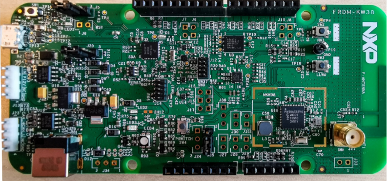
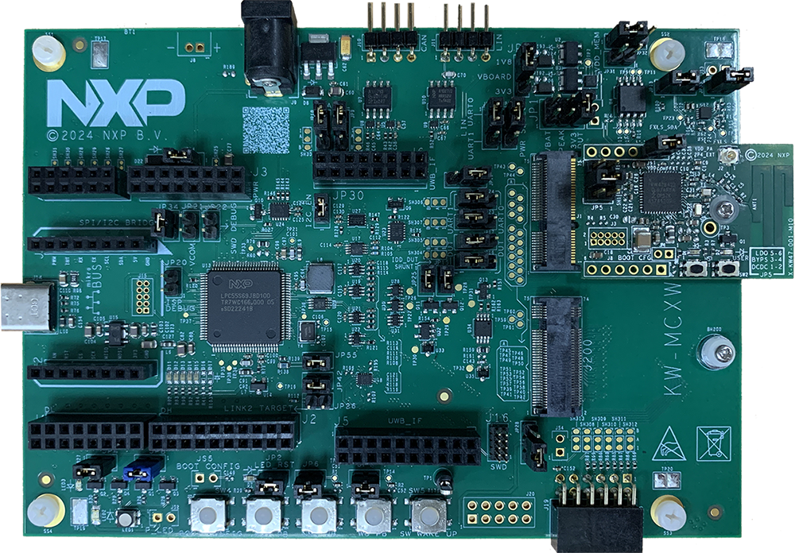
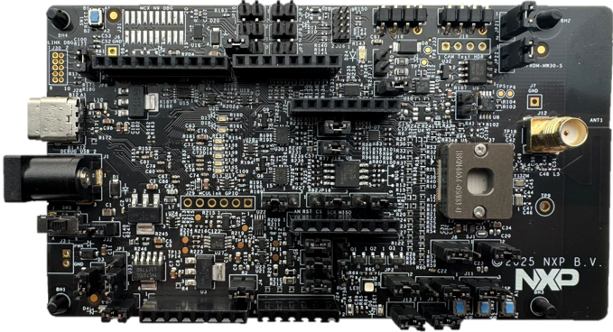

# CCC Digital Key hardware platforms

The CCC Digital Key R3 demo applications support the following platforms that have Bluetooth Low Energy transceiver capabilities:

-   FRDM-KW38 \(see [Figure 1](../images/kw38.png)\)

-   KW45B41Z-EVK \(see [Figure 2](../images/KW45B41Z-EVK-IMG.svg)\)

-   KW47-EVK \(see [Figure 3](../images/KW47_EVK.png) \)

-   FRDM-KW43 \(see [Figure 4](../images/FRDM-KW43.png) \)

**FRDM-KW38 board**

**KW45B41Z-EVK board**

**KW47-EVK board**

**FRDM-KW43 board**

