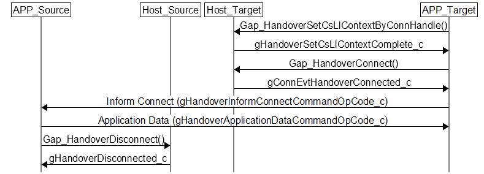

# Connection Handover

The Connection Handover procedure consists in the Target device taking over the connection from the Source device. It may be performed in two cases:

- After a successful Anchor Search procedure, as part of the standard handover flow.
- Directly without Time Synchronization or Anchor Search, when Anchor or Packet Monitoring is already active on the Target device.

**Connection Handover steps**
1. Target device calls `Gap_HandoverConnect()` to initiate the connection handover process.
2. Wait for the `gConnEvtHandoverConnected_c` event on the Target device. Once received, the connection has been successfully transferred.
3. Notify the Source device that the Target device has successfully connected to the Device.
4. Call `Gap_HandoverDisconnect()` on the Source device to terminate its connection.
5. The Handover Data is no longer required and may be freed by calling `Gap_HandoverFreeData()` on the Target device.
6. Application context may be transferred at this point through application specific means.

Additional steps for Channel Sounding applications:

For Channel Sounding applications, the Channel Sounding context must be transferred from the Source device to the Target device and set in the Link Layer **before** the Target device connects.
1. Retrieve the Channel Sounding context on the Source device by calling `Gap_HandoverGetCsLlContext()` and wait for the `gHandoverGetCsLlContextComplete_c` event.
2. Send the Channel Sounding context to the Target device.
3. Set the context in the Target device before connecting by calling `Gap_HandoverSetCsLlContextByConnHandle()` with the monitored connection handle, and wait for the `gHandoverSetCsLlContextComplete_c` event.
4. The Target device calls `Gap_HandoverConnect()` and waits for the `gConnEvtHandoverConnected_c` event, as in steps 1-2 above.
5. After the Target device reports it is connected, the Source device transfers any application context and then calls `Gap_HandoverDisconnect()` to terminate its connection. When complete, the `gHandoverDisconnected_c` event is sent.

**Connection Handover signaling chart**

The chart below shows the flow when Channel Sounding is enabled: the CS LL context is set before the connect. For applications without Channel Sounding, the CS context steps are omitted.

